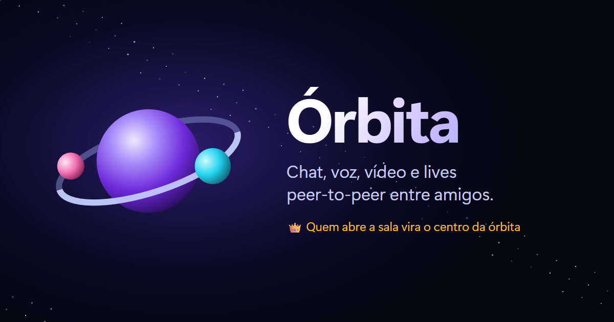

# 🪐 Órbita

Chat, voz, vídeo e lives **peer-to-peer**, direto no navegador. Quem abre a sala vira o **host** — o centro da órbita — e os amigos orbitam em volta.

**▶ Abrir o app: https://zelguilherme.github.io/orbita/**



## O que tem

- **Uma sala = um chat + uma chamada.** A chamada fica no meio, as pessoas à esquerda e o chat à direita (dá para esconder).
- **Convite por link ou código**, sem cadastro e sem conta. Você escolhe um nome e a cor do seu planeta.
- **Chat**: markdown (`**negrito**`, `*itálico*`, `` `código` ``, `||spoiler||`), menções com `@`, reações, edição, imagens, "fulano está digitando" e contador de não lidas.
- **Voz**: detecção de voz ou *pressionar para falar*, mutar e ensurdecer, volume por pessoa.
- **Filtros de som**: supressão de ruído do navegador ou por IA (RNNoise e GTCRN, rodando no seu computador), portão de ruído, corte de graves, compressor e volume do microfone, com teste e "ouvir meu microfone".
- **Atalhos editáveis** (teclado e botões laterais do mouse).
- **Câmera** na chamada.
- **Lives**: tela inteira, janela **com o som da janela** (Chrome/Edge/Brave 141+) ou aba, até 1080p a 60 fps. O som da própria chamada nunca vaza para a live. Qualidade, som, fonte e efeitos mudam com a live no ar. Quem assiste tem volume próprio para a live.
- **Laser e lápis**: quem assiste aponta com um laser e desenha por cima da live; os desenhos ficam até alguém clicar em "Apagar tudo". Tudo aparece para quem transmite e para todo mundo assistindo. Quem transmite pode abrir uma janela flutuante, sempre por cima, para ver o laser e os desenhos durante o jogo.
- **Chat redimensionável** (arraste a borda; dois cliques voltam ao padrão) e **atualização automática** quando sai uma versão nova.
- **Visão "Órbita" da chamada**: o host fica no centro com um anel dourado e os membros giram em volta.
- **Poderes do host**: silenciar para todos, remover, banir, trancar a sala, passar a coroa.
- **Migração automática de host**: se o host cair, o membro mais antigo assume e a sala continua.
- **Instalável** como app (PWA). Com o app instalado, convites abertos no navegador são entregues para o app (protocolo `web+orbita://`). O perfil é o mesmo no navegador e no app.

## Como funciona

```
                 servidor de sinalização (só para as pessoas se acharem)
                                  0.peerjs.com
                                       ┊
     Bruno ◀━━━━━━━━━━━━━━━━━  👑 Ana · host (hub)  ━━━━━━━━━━━━━━━━━▶ Carla
        ▲          dados: chat, membros, canais, permissões             ▲
        ┗━━━━━━━━━━━━━━━━━━━━ voz · câmera · lives ━━━━━━━━━━━━━━━━━━━━━┛
                               (malha P2P direta)
```

- **O hub roda no host.** O navegador de quem cria a sala reserva o ID `orbita-v1-sala-<código>` no servidor de sinalização. Todo mundo abre um DataChannel WebRTC com ele. O host é a autoridade da sala: guarda membros, canais, histórico do chat e permissões.
- **A mídia vai em malha.** Voz, câmera e telas passam direto entre as pessoas (WebRTC, criptografado com DTLS-SRTP). O host não vê nem retransmite a mídia de ninguém.
- **Migração de host.** Cada participante guarda uma cópia do estado. Se o hub some, o membro mais antigo reserva o mesmo ID da sala e sobe um hub novo, e os outros reconectam sozinhos. Como o servidor de sinalização só deixa um peer usar cada ID, nunca existem dois hosts ao mesmo tempo.
- **Nada fica salvo em servidor.** Quando a última pessoa sai, a sala deixa de existir.

### Limites

- A malha P2P funciona melhor com até 6–8 pessoas com câmera ligada. Só com voz, aguenta mais gente.
- Na live, o upload de quem transmite é dividido entre os espectadores (em 720p, cerca de 2,5 Mbps por pessoa assistindo).
- Por padrão o app usa o servidor público do PeerJS e o TURN público do PeerJS. Para uso sério, rode os seus (veja abaixo).
- Os navegadores de celular não transmitem a tela, mas assistem lives normalmente.
- A barra "compartilhando esta guia" é do navegador e não some ao transmitir uma aba. Para assistir sem ela, transmita a janela do navegador com o áudio do app.
- Os atalhos só funcionam com a janela do Órbita em foco (o navegador não deixa sites ouvirem o teclado em segundo plano).

## Rodando localmente

Precisa do Node.js 20.19+ (ou 22.12+).

```bash
npm install
npm run dev       # http://localhost:5173
npm run build     # gera dist/
npm run preview   # serve o build
```

Os navegadores só liberam microfone, câmera e tela em **HTTPS** ou em `localhost`. Para testar com outras pessoas, use o link publicado no GitHub Pages.

## Servidor de sinalização e TURN próprios (opcional)

```bash
npx -p peer peerjs --port 9000 --key peerjs --path /
```

Depois, no app, abra **Configurações › Rede** e informe host, porta, caminho e chave. Todo mundo da mesma sala precisa usar o mesmo servidor.

Em redes muito fechadas (4G, empresas, faculdades), um servidor TURN próprio (ex.: [coturn](https://github.com/coturn/coturn)) melhora a conexão. Cole a lista de servidores em JSON no campo **Servidores STUN/TURN**:

```json
[{ "urls": "stun:stun.l.google.com:19302" }, { "urls": "turn:seu-servidor:3478", "username": "usuario", "credential": "senha" }]
```

## Estrutura do código

```
src/
  lib/
    hub.ts         autoridade da sala (roda na aba do host)
    session.ts     conexão com o hub e migração de host
    media.ts       malha de voz/câmera e lives (WebRTC)
    wire.ts        canal JSON sobre DataChannel, com fatiamento de mensagens grandes
    protocol.ts    tipos das mensagens entre participantes e host
  components/      interface (React)
  controller.ts    liga a sessão, a mídia e a interface
  store.ts         estado da interface (Zustand)
```

Stack: React 19, TypeScript, Vite e PeerJS, com ícones do Lucide.

## Testes

```bash
npm run test:e2e
```

Abre várias pessoas de verdade no Edge ou no Chrome instalado (com câmera e microfone falsos) e testa: entrar pelo convite, chat, reações, malha de voz, câmera, live, queda do host com migração automática, passar a coroa, expulsão e o layout de celular. Usa o servidor público do PeerJS, então precisa de internet. Use `E2E_HEADED=1` para ver as janelas e `E2E_BROWSER=chrome` para trocar o navegador. As capturas de tela ficam em `test-results/`.

Para depurar a migração de host no navegador: `localStorage.setItem('orbita.debug', '1')` e recarregue a página.

## Publicação

Cada push na branch `main` gera o build e publica no GitHub Pages (`.github/workflows/deploy.yml`).

## Licença

[MIT](LICENSE)
